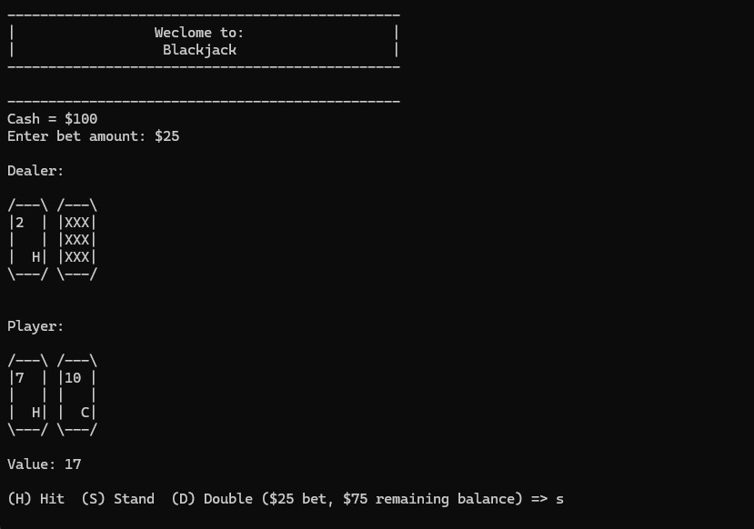
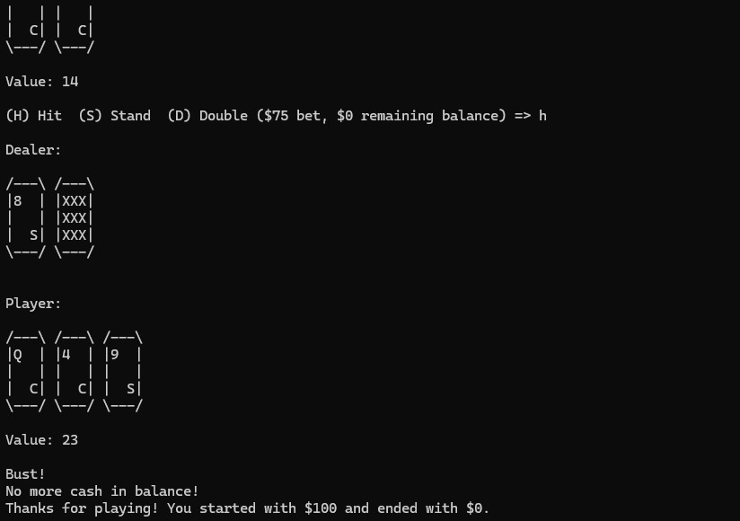
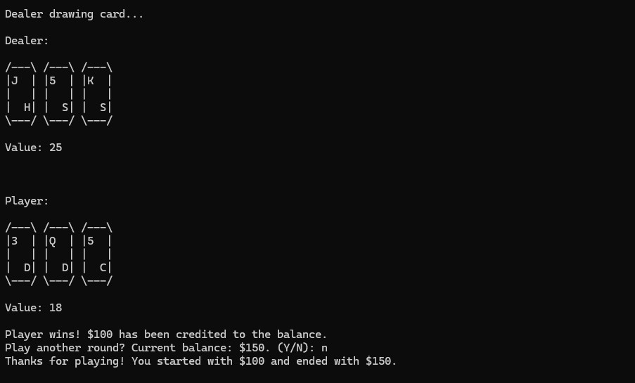

# Console Blackjack

Console Blackjack is a small blackjack game played entirely in the console. I made it to get more familiar with C++.

**Details:** C++20, console application

<p align="center">
  
  <br>
  <em>Placing a bet and playing a hand</em>
</p>

## Gameplay

The player starts with $100 and places a bet before each round. The goal is to beat the dealer's hand without going over 21. Cards are displayed using ASCII art, and one of the dealer's cards stays hidden during the player's turn.

The player can choose between three actions:

- **Hit (H):** Draw another card.
- **Stand (S):** End the player's turn and let the dealer play.
- **Double (D):** Double the current bet and draw another card, provided the player has enough money.

The dealer draws until their hand reaches at least 17. The round then ends with a win, loss, or tie, and the player's balance is updated. The player can continue into another round or stop, with a final message showing their starting and ending balances.

| Going over 21 | Winning after the dealer busts |
| :---: | :---: |
|  |  |

## Build and Run

Download and extract the repository using **Code > Download ZIP**, or clone it with Git. Choose either of the following build options.

### Visual Studio on Windows

1. Install Visual Studio with the **Desktop development with C++** workload.
2. Open [ConsoleBlackjack.sln](ConsoleBlackjack/ConsoleBlackjack.sln).
3. Select **Build > Build Solution**, or press **Ctrl+Shift+B**.
4. Select **Debug > Start Without Debugging**, or press **Ctrl+F5** to play.

The project is configured to use C++20.

### Using g++

Use **GCC 13.1 or newer**, since the project uses the C++20 `std::format` feature. Make sure `g++` is available in your terminal.

Start in the repository's root folder, which contains this README and the `ConsoleBlackjack` folder.

**Windows PowerShell**

Enter the source folder and compile:

```powershell
cd ConsoleBlackjack
g++ -std=c++20 main.cpp Blackjack.cpp Deck.cpp Hand.cpp Player.cpp Round.cpp -o blackjack.exe
```

After compilation succeeds, run:

```powershell
.\blackjack.exe
```

**Linux or a Bash terminal with a compatible GCC installation**

Enter the source folder and compile:

```bash
cd ConsoleBlackjack
g++ -std=c++20 main.cpp Blackjack.cpp Deck.cpp Hand.cpp Player.cpp Round.cpp -o blackjack
```

After compilation succeeds, run:

```bash
./blackjack
```

The compilation commands include all six `.cpp` files because the game logic is split across multiple files.

## Code Tour

These files are good starting points for looking through the project:

| File | What it handles |
| --- | --- |
| [Blackjack.cpp](ConsoleBlackjack/Blackjack.cpp) | Runs the overall game loop, asks for bets, starts rounds, and prompts the player to continue. |
| [Deck.cpp](ConsoleBlackjack/Deck.cpp) | Builds a 52-card deck, shuffles it, and deals cards while removing them from the deck. |
| [Round.cpp](ConsoleBlackjack/Round.cpp) | Deals the opening hands, handles player choices and the dealer's turn, and updates the balance based on the result. |
| [Hand.cpp](ConsoleBlackjack/Hand.cpp) | Stores the cards in a hand, calculates its value, and controls which cards are hidden. |
| [Card.h](ConsoleBlackjack/Card.h) | Represents individual cards and builds the ASCII display used to show cards side by side. |

## Looking Back

This project gave me practice working with C++ classes, structs, and standard library containers. Keeping the game small let me focus on how the pieces fit together, from dealing cards to updating the player's balance after a round.

Looking back, I would give the rule edge cases more attention. The ace calculation can currently reduce a hand's value too far, and doubling should end the player's turn after drawing one additional card. I would also separate console input and output from the game logic so those rules would be easier to test on their own.
